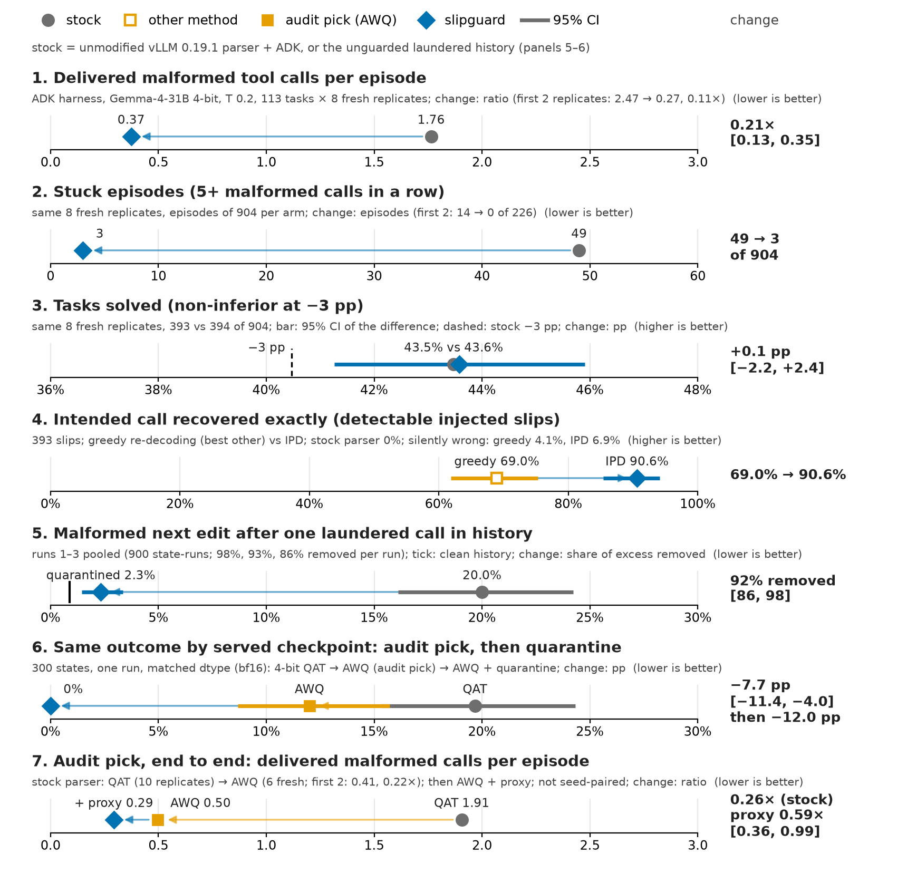
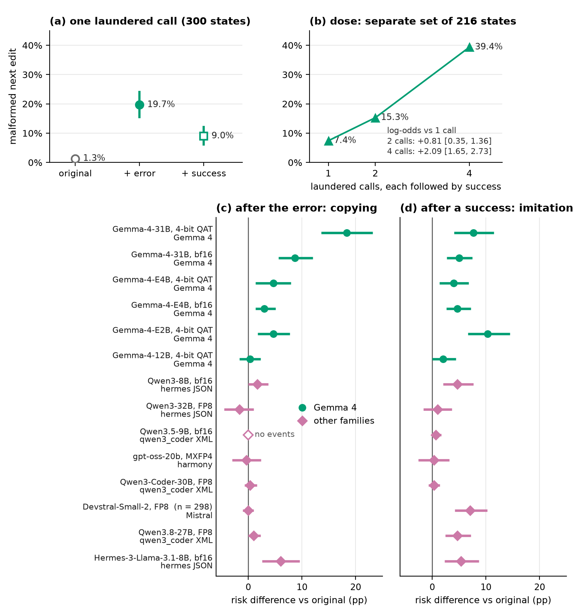

# slipguard: Stopping Gemma 4 Agents From Imitating Their Own Corrupted Tool Calls

### A library that protects Gemma 4 agents (slipguard), a benchmark for any model (TranscriptLab) and 1,181 Gemma 4 SWE-bench episodes (PNC)

## Abstract

Gemma 4 delimits tool-call strings with a special token. When it closes one with a look-alike, vLLM's parser can silently return a well-formed but wrong call (a *laundered* call); the agent framework stores it, and the model copies it. We release three resources: **slipguard**, a Gemma 4 library that refuses, repairs or quarantines (flags in the history) such calls and audits quantized checkpoints; **TranscriptLab**, a benchmark that edits one past action of a real agent state to measure how a corrupted history changes any model's next call; and **PNC** (Public Natural Corpus), 1,181 public Gemma 4 SWE-bench trajectories. In the challenge's agent harness (4-bit Gemma-4-31B), slipguard's repair proxy cuts malformed calls reaching the agent from 1.76 to 0.37 per episode in eight fresh replicates, with solved tasks non-inferior (393 stock vs 394 of 904 each; a 3-point drop excluded). The audit traces the damage to Google's QAT weights; serving its pick instead cuts malformed calls from 1.91 to 0.50 (0.26× in six fresh replicates; 0.22× in two earlier ones). One laundered call raises malformed next edits from 1.3% to 19.7% (first run); quarantine removes about 92% of the rise (85–98% across runs). Confirmatory analyses were pre-registered; failures are reported.

**Try it.** A CPU notebook re-derives 12 released values (https://www.kaggle.com/code/cassinicraft/slipguard-reproduce-numbers).

```bash
# slipguard, the library: protects a Gemma 4 agent
pip install "slipguard[proxy-frozen,adk] @ git+https://github.com/aneeshm11/slipguard#subdirectory=slipguard"
slipguard audit chats.jsonl --tools tools.json  # CPU: flags laundered calls in your logs
vllm serve google/gemma-4-31b-it --port 8000
slipguard proxy --backend http://127.0.0.1:8000/v1 --served google/gemma-4-31b-it --model-dir <dir> --logdir logs  # <dir>: tokenizer, chat template; agents use :8420/fullp/v1
P=$(slipguard plugin-path vllm)  # strict parser instead; needs slipguard in vLLM's environment
vllm serve google/gemma-4-31b-it --enable-auto-tool-choice --tool-parser-plugin "$P" --tool-call-parser gemma4_strict --reasoning-parser-plugin "$P" --reasoning-parser gemma4_strict
# TranscriptLab, the benchmark: scores any model; run it inside the Kaggle dataset (https://www.kaggle.com/datasets/cassinicraft/slipguard-pnc), a checkout with PNC
pip install "transcriptlab[run] @ git+https://github.com/aneeshm11/slipguard#subdirectory=transcriptlab"
transcriptlab run --base URL/v1 --model NAME --tokenizer HF_ID --pool A1 --arms P0,P1,P6,P8a --out DIR
transcriptlab report DIR
```

## 1 Introduction

Gemma 4 [1] writes a tool call as text, with each string between special `<|"|>` delimiters. Asked to replace `x = 0` with `x = 1`, it sometimes closes a string with a look-alike, here a backtick:

```text
<|tool_call>call:edit_file{filepath:<|"|>a.py<|"|>,new_string:<|"|>x = 1`,old_string:<|"|>x = 0<|"|>}<tool_call|>
```

Four steps turn one slip into a failing agent:

1. **Slip**: the model emits a wrong closing token, as above.
2. **Laundered**: vLLM's lenient parser reads on and returns a call that looks well-formed: `new_string` now holds ``x = 1`,old_string:`` and `old_string` is lost; nothing marks it as broken.
3. **Copied**: the agent framework stores that call in the history, which the model rereads every turn; a corrupted call there makes the next call more likely to be malformed (§2).
4. **Loop**: some episodes get stuck, repeating malformed calls five or more times in a row.

slipguard acts at steps 2 and 3: it refuses or repairs most broken calls instead of laundering them, and quarantines one already in the history. In the challenge's ADK (Agent Development Kit) harness (Gemma-4-31B, 4-bit, temperature 0.2), slipguard's proxy, which repairs and quarantines, cuts *delivered* malformed calls per episode from 1.76 to 0.37 (0.21× [0.13, 0.35]) and stuck episodes from 49 to 3 of 904 in eight fresh replicates (registered). Two earlier replicates (registered): 0.11× [0.06, 0.22]. Each component alone ends most post-slip loops in branched episodes (§4). In four of the eight fresh replicates (stock 1.56, full proxy 0.29), quarantine alone cut malformed calls per episode to 0.66 and IPD alone to 0.37 (registered).

Solved tasks: 393 stock vs 394 of 904 fresh episodes each, +0.1 pp [−2.2, 2.4], so the registered test excludes a 3-point drop (non-inferior); the two earlier replicates were too small to show this. Delivered counts miss silently wrong repairs (§4); only the solved-task test bounds those end to end.

**Table 2.** Resource card.

| Resource | Contents | Licence | Entry point |
|---|---|---|---|
| slipguard 0.1.2 (library) | strict parser and vLLM plugin, history guard, repair proxy, template, `audit`, `audit-weights`, conformance suite | Apache-2.0 | `pip install` (Try it) |
| TranscriptLab 0.1.3 (benchmark) | CLI, frozen runners and analyses, three public state pools | code Apache-2.0; states as PNC | `transcriptlab run`, `report` |
| PNC (dataset) | 1,181 episodes, 41,290 turns, 3.0 GB: exact requests, raw generations, parsed calls, tool results; SWE-bench grades for 1,167 (499 resolved); datasheet | CC BY 4.0; repository licences kept | https://www.kaggle.com/datasets/cassinicraft/slipguard-pnc |

**Terms.** *Malformed*: failing a fixed judge (vLLM 0.19.1's parse plus required-argument and declared-key checks); a laundered call is malformed but looks well-formed; *delivered*: as the agent receives it, after any repair. *Quarantine*: replacing a malformed call in the history with the recovered call plus an explicit error. *IPD* (intent-preserving decoding): rolling back to the slip, inserting the true delimiter and letting the model continue. *4-bit QAT*: Google's quantization-aware-trained checkpoints; *AWQ*: a post-training 4-bit method [20]; *bf16*: unquantized. *Registered*: the analysis was hash-frozen before data; otherwise *exploratory*.



**Figure 1.** Stock stack or best other method vs slipguard on seven public-data results (95% CIs where shown; §4).

## 2 Why the library must clean the history

TranscriptLab takes a real agent state from PNC, edits one past action, and samples the next call with one seed per state. On 300 states (first run), replacing the latest valid edit with its laundered form plus the framework's resulting error raises malformed next edits from 1.3% to 19.7% (+18.3 pp [13.6, 23.2]): the model copies the corruption. Followed instead by its original success response, the laundered edit is still imitated, and more such edits raise the rate further (Fig. 2; Table 3).

A more informative error message still leaves 76% of the excess over the original history. Quarantine removes most of it: 92% [86, 98] in the pre-specified descriptive pool of three runs (900 samples per arm; runs 98%, 93%, 86%). Removal is 88% at temperature 0.6 and 92% under greedy decoding. Logs cannot tell a history effect from error-prone episodes; only editing the history can.



**Figure 2.** TranscriptLab. (a) One laundered edit, 300 states. (b) Dose: 1, 2 or 4 laundered edits, each followed by success, on another pool of 216 states. (c, d) Copying and imitation in 14 configurations (Table 3).

## 3 slipguard design

slipguard's components:

- **parse**: `slipguard.parse` and a vLLM plugin (`gemma4_strict`), a streaming parser that delivers a call only when its text is grammar-valid (`gemma4_strict_schema` also checks the declared schema) and returns anything else as plain text (fail-loud). In ADK a text-only answer ends the turn, so pair it with the proxy or the history guard;
- **history**: a guard with ADK and LiteLLM hooks that quarantines malformed calls already in the history;
- **repair**: `slipguard proxy`, an OpenAI-compatible proxy in front of vLLM that quarantines the history and, only when a finished turn holds an invalid call, applies IPD; turns with only valid calls pass byte-identical, and calls it cannot repair are delivered as vLLM parses them;
- **template**: Google's July 2026 chat template, patched for two edge cases;
- **weights**: `slipguard audit-weights` measures, through any vLLM endpoint, how much less confidently a quantized checkpoint closes code strings with the true delimiter than the bf16 model.

**Evaluated vs derived.** Only the frozen proxy and IPD (vLLM 0.19.1, shipped byte-identical) were evaluated end to end; the plugin (vLLM 0.19.1, 0.24, 0.31–0.33) and other history transforms have only conformance, GPU smoke and load-soak tests.

## 4 Gains on public data

**Table 1.** slipguard's gains on public data.

| Failure mode | Stock or best other | slipguard |
|---|---|---|
| Wrong call delivered for an ill-formed turn of known intent (218 PNC turns, mostly `key=value` drift) | vLLM built-ins: 188–216 | 0: strict parser refuses all, as transformers' reference parser does |
| Malformed next edit after a laundered edit (three runs pooled) | 20.0% (original: 0.9%) | quarantine: 92% [86, 98] of excess removed |
| Same, one run per checkpoint | 4-bit QAT: 19.7% | audit's pick, AWQ: 12.0% [8.7, 15.7]; with quarantine, 0% |
| Exact intent recovered (393 detectable injected slips) | stock 0%; greedy 69.0%; text-only repair 83.6% | IPD 90.6% [85.4, 94.1] |
| Delivered malformed calls per episode (113 tasks, mostly fastapi, rich) | 1.76 (8 fresh replicates); 2.47 (first 2) | 0.37 (0.21×); 0.27 (0.11×) |

**End to end** (registered; temperature 0.2 only). Branching 135 real episodes at a first slip (122 injected; 13 natural ones agree, exploratory) and continuing each with one component, quarantine alone cuts malformed calls after the slip from 11.6 to 0.18 per branch, IPD alone to 0.11 (registered ≥50% rule met).

**Repair** (registered). IPD recovers the intended call most often, +7.0 pp [3.2, 11.2] over slipguard's text-only repair, and changed none of 582 valid calls. The price is silent corruption, a wrong call the judge cannot flag: 6.9% of detectable injected slips, against 1.1% for the stock parser (whose wrong calls are mostly flaggable) and 4.1% for greedy; its registered silent-corruption tests failed.

**Weight audit.** `audit-weights` ranked 15 checkpoints on 454 held-out PNC string ends. Google's 4-bit QAT release loses 5.13 nats (natural-log units) of log-probability margin for the true delimiter versus bf16; a community AWQ export of the bf16 weights loses only 0.02. The loss follows the QAT weights, not the 4-bit format: the unquantized QAT weights lose 5.5, and their AWQ and NVFP4 exports 6.0 and 7.4, against 0.02 and 1.4 for exports of the bf16 weights. So does behaviour: after a laundered edit, every QAT-weight checkpoint, unquantized included (registered), makes 18–24% malformed next edits and every bf16-weight one 7–13% (11 checkpoints, descriptive); the deficit ranks the seven pre-specified ones (ρ = 0.89, p = 0.006, registered). Audit any new Gemma 4 checkpoint; with the shipped bf16 records (31B, E4B), only it needs serving. Serving the audit's pick, AWQ, instead of QAT cuts malformed next edits after a laundered edit from 19.7% to 12.0% (matched dtype; registered), and quarantine on top removes the rest. End to end, the pick alone cuts delivered malformed calls per episode from 1.91 to 0.41 (0.22× [0.11, 0.39]; 0.26× in six fresh replicates; registered, not seed-paired); in those six the proxy still cuts 0.50 to 0.29 (0.59× [0.36, 0.99], registered). End to end, the audit's flags sorted all six checkpoints tested: flagged ones delivered 1.9–4.8 malformed calls per episode, unflagged ones 0.34–0.47 (registered); the proxy cut every checkpoint but bf16 (0.42 → 0.45, n.s.), the QAT exports from 3.8 and 4.8 to 0.19 and 0.27.

**Conformance.** On slipguard's 16-class conformance suite (13,612 inputs; 2,652 public, the rest withheld for licensing, provenance or security), built-in parsers of vLLM, SGLang and llama.cpp fail 10 to 13 classes, transformers' 2, slipguard's none on non-streaming paths.

## 5 TranscriptLab and PNC as reusable resources

**PNC.** The 4-bit QAT Gemma-4-31B (thinking on, temperature 1.0) ran a generic agent harness on 400 SWE-bench Verified [2] tasks, 100 of them again with a second tool schema, and 681 non-Verified tasks.

**TranscriptLab states.** A state is the exact prompt before a logged edit call in a PNC episode. Pool A1 (300 states) has a clean history whose latest edit was valid and succeeded; A2 (216) has at least four such edits, for the dose curve; B1 (600) precedes an episode's first edit.

**Scoring a new model** takes one command (Try it): 300 states × 4 history variants (original, laundered + error, laundered + success, quarantined) = 1,200 generations from any `/v1/completions` server that accepts raw prompts with special tokens. The report gives copying, imitation and quarantine removal with 95% CIs.

**Out of scope:** training on PNC as clean demonstrations (it contains laundered calls).

The history guard is four lines in an ADK agent:

```python
from google.adk.agents import LlmAgent
from slipguard.integrations.adk import guarded_lite_llm
model = guarded_lite_llm("hosted_vllm/google/gemma-4-31b-it", api_base="http://127.0.0.1:8000/v1")
agent = LlmAgent(name="coder", model=model, tools=[read_file])  # your tools; history cleaned before every call
```

**Table 3.** TranscriptLab leaderboard on the 300 A1 states (298 for Devstral): change in malformed next edits (pp, 95% CI) after one laundered edit followed by the error (copying) or by its success response (imitation; "induction" in the registrations). *History-sensitive*: a CI lower bound above 0 (descriptive; registered for the 31B bf16, E2B, E4B bf16 and Hermes rows). States and corruption come from 4-bit QAT Gemma-4-31B histories; all other rows are off-policy.

| Model, weights (tool format) | Copying | Imitation | History-sensitive |
|---|---|---|---|
| Gemma-4-31B, 4-bit QAT | +18.3 [13.6, 23.2] | +7.7 [4.1, 11.5] | yes |
| Gemma-4-31B, bf16 | +8.7 [5.7, 12.0] | +5.0 [2.7, 7.5] | yes |
| Gemma-4-E4B, 4-bit QAT | +4.7 [1.4, 8.0] | +4.0 [1.3, 6.8] | yes |
| Gemma-4-E4B, bf16 | +3.0 [1.3, 5.1] | +4.7 [2.6, 7.2] | yes |
| Gemma-4-E2B, 4-bit QAT | +4.7 [1.7, 7.7] | +10.3 [6.6, 14.4] | yes |
| Gemma-4-12B, 4-bit QAT | +0.3 [−1.7, 2.3] | +2.0 [0.0, 4.4] | no |
| Qwen3-8B [3], bf16 (JSON) | +1.7 [0.0, 3.7] | +4.7 [2.0, 7.7] | yes |
| Qwen3-32B [3], FP8 (JSON) | −1.7 [−4.5, 1.0] | +1.0 [−1.7, 3.7] | no |
| Qwen3.5-9B [21], bf16 (XML) | no events | +0.7 [0.0, 1.7] | no |
| gpt-oss-20b, MXFP4 (harmony) | −0.3 [−3.0, 2.4] | +0.3 [−2.6, 3.2] | no |
| Qwen3-Coder-30B, FP8 (XML) | +0.3 [−0.7, 1.6] | +0.3 [−0.7, 1.4] | no |
| Devstral-Small-2, FP8 (Mistral) | 0.0 [−1.0, 1.0] | +7.0 [4.2, 10.2] | yes |
| Qwen3.8-27B, FP8 (XML) | +1.0 [0.0, 2.3] | +4.7 [2.4, 7.2] | yes† |
| Hermes-3-Llama-3.1-8B, bf16 (JSON) | +6.0 [2.6, 9.6]‡ | +5.3 [2.3, 8.7] | yes |

† misses its registered rule (imitation ≥ 5 pp). ‡ none of its 28 malformed edits copies the laundered call; the error makes it retry edits.

## 6 Limitations and reproducibility

**What did not work.**

- The full stack (history guard, IPD, strict parser) on corrupted histories got the registered verdict *gain with harm*, so we claim no gain from it: its no-harm rule counted IPD repairs of grammar-invalid calls the judge passes (1 of 1,500 and 3 of 600 samples).
- Reruns with new seeds and the released CLI reproduced copying, but quarantine removed only 85–93%, below the registered 90% twice.
- A 2-hour overload soak failed its timeout gates: 1–2% of requests timed out on every route, stock included, and more of slipguard's verify-first streams did (4 of 255 vs 0 of 235). Nothing crashed; no laundered call passed slipguard (10 schema-invalid ones did, by design).
- Three registered weight-repair candidates failed their gates; we ship the audit, not a repair.
- On the audit's pick, two replicates missed the predicted proxy cut (0.77× [0.44, 1.47]; predicted ≤ 0.3), and the fresh QAT replicates' 0.21× fell outside the predicted 0.07–0.18.
- Masking e-mail addresses in the released PNC changed the result (registered no-change check failed, p = 0.02); copying on it is +15.0 and +16.7 pp in two runs.
- Other failed predictions: LIMITATIONS §14.

**Provenance.** The registration ledger and hashes ship in the repository (`tools/verify_preregs.py`). The judge is pinned by hash. All states come from one harness and one model's histories, and blinding lapses are disclosed (LIMITATIONS).

**Note to the organizers.** We found parser bugs that we do not release, because they could be used to exploit ongoing competitions built on Gemma. We ask the organizers to contact us for access.

## 7 Related work

**Resources.** SWE-Gym [15] and SWE-smith [16] release agent trajectories for training; PNC adds the raw protocol text and parsed calls. BFCL [17] and τ-bench [18] score whether tool calls are right; TranscriptLab measures how a wrong call already in the history changes the next one. **Self-conditioning and agent failures.** Models condition on their own earlier errors [7], small models repeat a just-failed call [8], and failed attempts contaminate retries [9]. **Copying, decoding, serving.** Induction heads copy from context [10]; constrained decoding guarantees syntax [6] but recovers no intended call here; practitioners report Gemma 4 parser failures in vLLM [19] itself [5, 11] and in other runtimes [4, 12]; and quantization leaves tool use nearly intact on benchmarks [13] yet amplifies failures [14].

## References

[1] Gemma Team. Gemma 4 Technical Report. arXiv:2607.02770, 2026.

[2] C. E. Jimenez et al. SWE-bench: Can Language Models Resolve Real-World GitHub Issues? ICLR 2024; OpenAI. Introducing SWE-bench Verified. Aug. 2024.

[3] Qwen Team. Qwen3 Technical Report. arXiv:2505.09388, 2025.

[4] SGLang issue #42791: gemma4 tool-call parser hangs forever on a stray "]" in an array argument. 2026.

[5] vLLM PR #41991: Fix infinite loop and array boundary issues in the Gemma 4 tool parser. 2026.

[6] Y. Dong et al. XGrammar: Flexible and Efficient Structured Generation Engine for Large Language Models. MLSys 2025.

[7] A. Sinha et al. The Illusion of Diminishing Returns: Measuring Long Horizon Execution in LLMs. ICLR 2026.

[8] E. Gumaan. Feedback That Backfires: Why Small Language Model Agents Repeat the Call They Just Watched Fail. arXiv:2608.23651, 2026.

[9] Z. Yang. Why Retrying Fails: Context Contamination in LLM Agent Pipelines. arXiv:2605.08563, 2026.

[10] C. Olsson et al. In-context Learning and Induction Heads. Transformer Circuits Thread, 2022. arXiv:2209.11895.

[11] vLLM issue #39072: Gemma 4 edit calls omit the required `path`. 2026.

[12] FastFlowLM PR #905: a quote inside a Gemma 4 string value no longer ends the value. 2026.

[13] P. Dong et al. Can Compressed LLMs Truly Act? An Empirical Evaluation of Agentic Capabilities in LLM Compression. ICML 2025.

[14] J. Jang et al. Flat Score, Amplified Failures: How the Error Budget Masks Damage in Quantized LLM Agents. arXiv:2607.27275, 2026.

[15] J. Pan et al. Training Software Engineering Agents and Verifiers with SWE-Gym. ICML 2025.

[16] J. Yang et al. SWE-smith: Scaling Data for Software Engineering Agents. NeurIPS 2025 Datasets and Benchmarks Track.

[17] S. G. Patil et al. The Berkeley Function Calling Leaderboard (BFCL): From Tool Use to Agentic Evaluation of Large Language Models. ICML 2025.

[18] S. Yao et al. τ-bench: A Benchmark for Tool-Agent-User Interaction in Real-World Domains. ICLR 2025.

[19] W. Kwon et al. Efficient Memory Management for Large Language Model Serving with PagedAttention. SOSP 2023 (vLLM).

[20] J. Lin et al. AWQ: Activation-aware Weight Quantization for LLM Compression and Acceleration. MLSys 2024.

[21] Qwen Team. Qwen3.5: Towards Native Multimodal Agents. Blog post and model card Qwen/Qwen3.5-9B, Feb. 2026.
